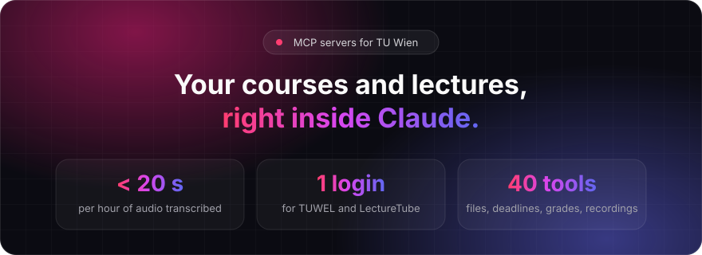
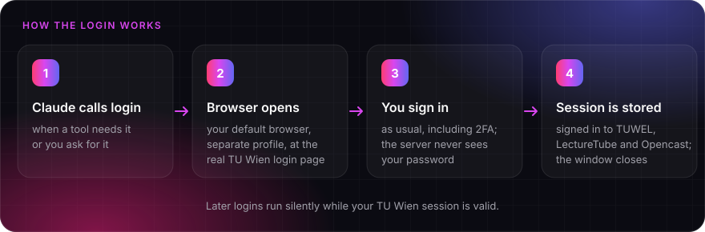

<p align="center">
  
</p>

<h1 align="center">TU Wien for Claude</h1>

<p align="center">
  
</p>

<p align="center">
  <a href="https://swordpro3001.github.io/TUWIEN-MCP/tests/"></a>
  <a href="https://swordpro3001.github.io/TUWIEN-MCP/coverage/"></a>
  <a href="https://github.com/Swordpro3001/TUWIEN-MCP/releases/latest"></a>
  <a href="#install"></a>
  <a href="LICENSE"></a>
</p>

<p align="center">
  <a href="#install">Install</a> &nbsp;|&nbsp;
  <a href="#what-it-can-do">What it can do</a> &nbsp;|&nbsp;
  <a href="#transcription">Transcription</a> &nbsp;|&nbsp;
  <a href="#login-and-privacy">Login and privacy</a> &nbsp;|&nbsp;
  <a href="#configuration">Configuration</a> &nbsp;|&nbsp;
  <a href=".github/CONTRIBUTING.md">Contributing</a>
</p>

Two unofficial [MCP](https://modelcontextprotocol.io) servers that let Claude read your courses, files, deadlines and
lecture recordings, so you can ask things like:

> *"What's due this week, and what do I still need to hand in?"*<br>
> *"Summarise this week's material of Analysis 2, including the lecture recording."*<br>
> *"Make me an exam prep sheet from all slides and transcripts of 101.883."*

> [!NOTE]
> Not affiliated with TU Wien. Respect the terms of use and the licenses of the material.
> Summaries of course-only recordings are for your personal use.

## Install

**Requirements:** Java 17+ and, for transcription and keyframes, [`ffmpeg`](https://ffmpeg.org) on the `PATH`.

1. Download `tuwel-mcp.jar` and `lecturetube-mcp.jar` from the [latest release](https://github.com/Swordpro3001/TUWIEN-MCP/releases/latest),
   or build them with `./gradlew allJars` (into `build/libs/`).
2. Add them to `claude_desktop_config.json`:
   ```json
   {
     "mcpServers": {
       "tuwel":       { "command": "java", "args": ["-jar", "/path/to/tuwel-mcp.jar"] },
       "lecturetube": { "command": "java", "args": ["-jar", "/path/to/lecturetube-mcp.jar"] }
     }
   }
   ```
   Claude Code: `claude mcp add tuwel -- java -jar /path/to/tuwel-mcp.jar` (same for `lecturetube`).
3. Restart the client. `java -jar tuwel-mcp.jar doctor` checks the setup.

## What it can do

<table>
<tr>
<td width="50%" valign="top">
<h3>TUWEL</h3>
<b>Read course material</b><br>
PDFs, Word, PowerPoint, Excel, OpenDocument, notebooks, code and images, plus <b>ZIP archives</b> without unpacking.
<br><br>
<b>Stay on top of deadlines</b><br>
Upcoming deadlines, calendar, assignments with submission status, grades and feedback.
<br><br>
<b>Follow the forums</b><br>
Announcements, Q&amp;A discussions, notifications and what changed in a course.
</td>
<td width="50%" valign="top">
<h3>LectureTube</h3>
<b>Find lectures</b><br>
Search the whole catalogue, including <b>words spoken</b> in captioned lectures.
<br><br>
<b>"Listen" to recordings</b><br>
Transcripts with <code>[hh:mm:ss]</code> timestamps, for LectureTube and for videos uploaded to TUWEL.
<br><br>
<b>See the slides</b><br>
Finds slide changes in the video and shows them next to what was said.
</td>
</tr>
<tr>
<td width="50%" valign="top">
<b>Transcribe anything</b><br>
Creates captions for the roughly 90% of recordings that have none, in the cloud or locally.
</td>
<td width="50%" valign="top">
<b>Summarise</b><br>
A whole course or week, combining pages, files and recordings into one summary or exam prep sheet.
</td>
</tr>
</table>

<details>
<summary><b>All tools and prompts</b></summary>
<br>

**TUWEL:** `list_courses`, `search_courses`, `get_course`, `search_course`, `course_updates`, `list_files`,
`read_file`, `read_zip`, `read_module`, `upcoming_deadlines`, `calendar`, `list_assignments`, `get_assignment`,
`get_grades`, `list_forums`, `list_discussions`, `read_discussion`, `notifications`, `course_recordings`,
`listen_recording`, `summarize`<br>
Prompts: `weekly_briefing`, `study_week`, `assignment_helper` (explains, doesn't solve), `exam_prep`

**LectureTube:** `search_lectures`, `list_lectures`, `list_series`, `get_series`, `get_lecture`, `get_transcript`,
`get_slides`, `browse_pages`, `my_profile`, `my_videos`, `my_series`, `graphql_query` (read-only).
Public lectures work without login.<br>
Prompts: `summarize_lecture`, `exam_prep`

**Both:** `login`, `auth_status`, `logout`, `transcribe_recording`, `transcription_status`, `analyze_keyframes`

</details>

## Transcription

Only about 8.5% of LectureTube recordings have captions, and videos uploaded to TUWEL have none.
`transcribe_recording` fills the gap. Claude gets the transcript as soon as it is ready, and you get a desktop
notification when a long job finishes.

<p align="center">
  
</p>

<table>
<tr><th></th><th>Cloud (recommended)</th><th>Local</th></tr>
<tr><td><b>Speed</b></td><td><b>under 20 s per hour of audio</b></td><td>about 7 min per hour (<code>small</code> model)</td></tr>
<tr><td><b>Your CPU</b></td><td>a few seconds</td><td>all cores, the whole time</td></tr>
<tr><td><b>Cost</b></td><td>about $0.04 per hour of audio</td><td>free</td></tr>
<tr><td><b>Engine</b></td><td>Groq <code>whisper-large-v3-turbo</code>, or any OpenAI-compatible API</td><td>bundled Whisper (whisper.cpp)</td></tr>
<tr><td><b>Audio leaves your computer</b></td><td>yes, to the provider</td><td>no</td></tr>
</table>

**Enable the cloud engine:** get a key at [console.groq.com](https://console.groq.com) and save it in
`~/.config/lecturetube-mcp/transcription.json` (then `chmod 600` it):

```json
{ "apiKey": "gsk_..." }
```

> [!IMPORTANT]
> With the cloud engine the recording's audio is sent to the provider. Course-only recordings can contain other
> students' voices. Use `engine: local` where that is not acceptable. Nothing is uploaded until you add a key.

Results are cached, and interrupted jobs resume where they stopped.

## Login and privacy

<p align="center">
  
</p>

- **The server never sees your password.** You log in on the real TU Wien page.
- **Later logins are silent** while your TU Wien session is valid.
- The session lives in `~/.config/lecturetube-mcp/session.json` (owner-only). Treat it like a password;
  `logout` deletes it.
- For TUWEL a Moodle app token is created. You can revoke it under *Preferences > Security keys*.
- Works with Chromium-based browsers (Chrome, Edge, Brave, Opera, Vivaldi, ...) and Firefox-based ones.

## Configuration

All optional. Set them as environment variables. `transcription.json` supports only `engine`, `provider`,
`apiUrl`, `apiKey`, `model`, `pricePerHour`, `parallel`, and `audioFormat`; the other settings below are environment-only.

| Variable | Purpose |
|---|---|
| `TRANSCRIBE_API_KEY` | Enables cloud transcription |
| `TRANSCRIBE_ENGINE` | Default engine: `api` or `local` |
| `TRANSCRIBE_API_PROVIDER`, `_URL`, `_MODEL` | `groq` (default), `openai`, or `custom` with your own base URL |
| `TRANSCRIBE_API_FORMAT` | Upload as `flac` (default) or `opus` (about 8x smaller) |
| `TRANSCRIBE_WAIT_SECONDS` | How long one tool call waits for a transcript (default 50) |
| `TRANSCRIBE_NOTIFY` | `0` turns desktop notifications off |
| `LECTURETUBE_WHISPER_MODEL` | Local model: `tiny`, `base`, `small` (default), `medium`, `turbo`, `large` |
| `WHISPER_CLI`, `FFMPEG`, `FFPROBE` | Paths to external tools (a GPU `whisper-cli` is used automatically) |
| `LECTURETUBE_BROWSER` | Login browser instead of the system default |
| `LECTURETUBE_MCP_HOME` | Data folder (default `~/.config/lecturetube-mcp`) |
| `LECTURETUBE_MEDIA_CACHE_GB` | Video cache limit (default 5) |

Command line: `java -jar tuwel-mcp.jar login | status | logout | doctor` (same for `lecturetube-mcp.jar`).

## Development

```bash
./gradlew test         # run the tests
./gradlew allJars      # build both jars into build/libs/
```

<details>
<summary><b>Project layout</b></summary>
<br>

```
docs/                     API research (OpenAPI for LectureTube and TUWEL, Tobira GraphQL schema)
src/main/kotlin/dev/
  lecturetubemcp/         LectureTube server
    auth/                 shared TU Wien login (browser automation, session store)
    api/                  Tobira GraphQL / Opencast client, transcripts
    media/                transcription (local + cloud), keyframes, video cache
    mcp/                  MCP tools
  tuwelmcp/               TUWEL server
    moodle/               Moodle web service client, TUWEL operations, course recordings
    files/                PDF / Office / ZIP readers
    mcp/                  MCP tools
```

</details>

**Workflow:** pull requests and every merge to `main` run the tests. After a merge, the [test report](https://swordpro3001.github.io/TUWIEN-MCP/tests/) and [coverage report](https://swordpro3001.github.io/TUWIEN-MCP/coverage/) are published to GitHub Pages; Dependabot keeps dependencies current.
Releases are created by hand (*Actions > Release > Run workflow*): the version and `CHANGELOG.md` are derived from
[Conventional Commits](https://www.conventionalcommits.org) (`feat(scope): ...`, `fix: ...`, `docs: ...`), and both
jars are published as a GitHub release.

## License

[MIT](LICENSE)
